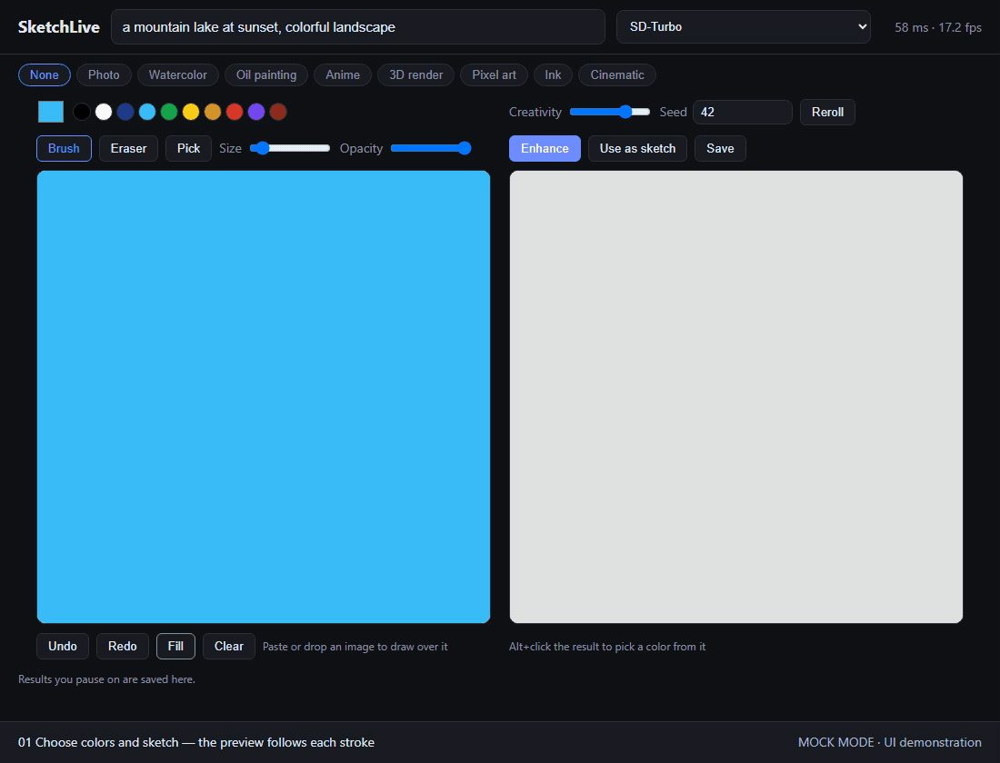

# SketchLive: an open-source Krea real-time alternative



*Recorded with the real SD-Turbo model on an RTX 3090: sketching a mushroom cottage, live AI preview, undo/redo, and Enhance/history. Cinematic style, Creativity 0.90, seed 42; generated results are shown directly from the app.*

An open-source, self-hosted take on real-time AI drawing, inspired by Krea's real-time canvas: sketch on the left, and a diffusion model repaints your sketch on the right as you draw, guided by a text prompt. Runs locally on your own GPU.

> **Not affiliated with Krea.** SketchLive is an independent community project. It is not made, endorsed or supported by Krea AI; "Krea" is used only to describe what kind of tool this is.

## How it works

```
browser canvas ──PNG frame──▶ WebSocket ──▶ img2img (SD-Turbo, 1 step, TAESD) ──JPEG──▶ browser
```

- **Few-step model.** Distilled models (SD-Turbo, SDXL-Turbo, LCM) produce a usable image in a single denoising step. With the TAESD tiny autoencoder, a frame takes ~54 ms on an RTX 3090 (~15 fps end to end in the browser).
- **img2img, not text-to-image.** Your sketch is the starting image; the *Creativity* slider sets how much noise is added before the one denoising step (low = stick to your lines, high = let the model invent). It's mapped straight to a custom timestep, because diffusers' `strength` rounds to whole steps and would collapse most of the slider onto one value.
- **Fixed seed.** The seed stays constant between frames so the picture evolves smoothly instead of flickering. *Reroll* picks a new one.
- **Backpressure.** The client keeps at most one frame in flight and the server only processes the newest frame, so latency never piles up while you draw fast.

## Features

- **Live canvas**: brush with pen pressure, eraser, opacity, eyedropper, fill, undo/redo, size cursor
- **Paste or drop an image** onto the canvas to paint over a photo or reference
- **Style chips** (Photo, Watercolor, Anime, 3D render, …) appended to your prompt
- **Model dropdown** with five presets (see below)
- **Enhance**: re-renders the current frame with more steps and the model's full VAE
- **History strip**: results are saved when you pause; click one to bring it back
- **Fixed, editable seed** for reproducible results; settings are remembered between visits
- Side-by-side layout that scales up to large monitors and stacks on phones

### Shortcuts

| Key | Action |
|---|---|
| `B` / `E` / `I` | Brush / eraser / eyedropper |
| `Alt`+click | Pick a color from the canvas or the result |
| `[` / `]` | Smaller / bigger brush |
| `Ctrl+Z` / `Ctrl+Shift+Z` | Undo / redo |
| `Ctrl+Enter` | Enhance |
| `Ctrl+V` | Paste an image onto the canvas |

## Run it

```bash
python -m venv .venv
.venv\Scripts\activate          # Windows; use `source .venv/bin/activate` elsewhere
pip install torch --index-url https://download.pytorch.org/whl/cu121
pip install -r requirements.txt
python server.py
```

Open http://127.0.0.1:7860. The first run downloads the model (~2.5 GB).

No GPU? `python server.py --mock` serves the full UI with a fake generator, handy for frontend work (only `fastapi`, `uvicorn` and `pillow` are needed).

### Models

Pick a model from the dropdown in the header; it loads on first use (the two most recent stay on the GPU, so switching back is instant). Timings are GPU time per 512px frame on an RTX 3090 with TAESD.

| Preset | Model | ms/frame | Weights license |
|---|---|---|---|
| `sd-turbo` (default) | [stabilityai/sd-turbo](https://huggingface.co/stabilityai/sd-turbo), 1 step | ~55 | Stability AI Community |
| `sdxs` | [IDKiro/sdxs-512-0.9](https://huggingface.co/IDKiro/sdxs-512-0.9), 1 step | ~37 | OpenRAIL++ |
| `dreamshaper` | [Lykon/dreamshaper-8](https://huggingface.co/Lykon/dreamshaper-8) + LCM-LoRA, 2 steps | ~85 | CreativeML OpenRAIL-M |
| `realistic` | [Realistic Vision 5.1](https://huggingface.co/SG161222/Realistic_Vision_V5.1_noVAE) + LCM-LoRA, 2 steps | ~95 | CreativeML OpenRAIL-M |
| `anime` | [Lykon/AnyLoRA](https://huggingface.co/Lykon/AnyLoRA) + LCM-LoRA, 2 steps | ~83 | CreativeML OpenRAIL-M |

SDXS is the fastest but was distilled for one step from pure noise, so it looks washed out below ~0.85 Creativity. Any SD 1.5 fine-tune can be added as an LCM preset in `PRESETS` in `server.py`.

### Options

| Flag | Default | |
|---|---|---|
| `--model` | `sd-turbo` | Preset loaded at startup (see above); also `SKETCHLIVE_MODEL` env var |
| `--full-vae` | off | Use the model's full VAE instead of TAESD: sharper, ~3x slower (~158 ms/frame on a 3090) |
| `--compile` | off | `torch.compile` the UNet: slow first start, noticeably faster frames |
| `--device` | `cuda` | `mps` works on Apple Silicon (slower) |
| `--host` / `--port` | `127.0.0.1` / `7860` | |

## Model licenses

The code is MIT. Model weights carry their own licenses (table above): SD-Turbo is under Stability AI's community license (check its commercial-use terms); the other presets use OpenRAIL-family licenses, which allow commercial use with use-based restrictions. Verify on each model card.

## Roadmap ideas

- pix2pix-turbo sketch mode for clean line drawings
- ControlNet scribble/lineart conditioning for tighter line adherence
- StreamDiffusion / TensorRT backend for 30+ fps
- Layers, webcam/screen input
